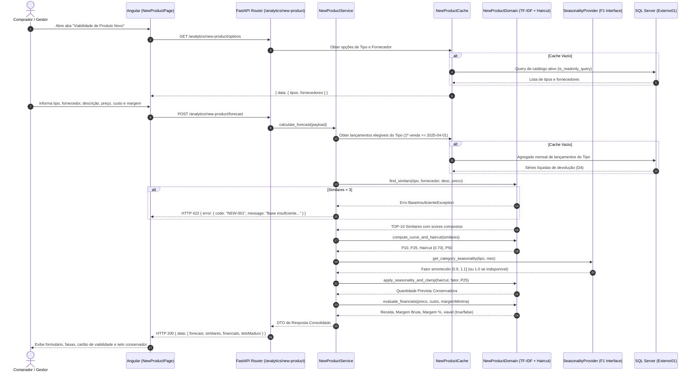

# ADR-008: Viabilidade de Produto Novo com Previsão Conservadora, Busca Híbrida de Similares e Consumo Desacoplado de Sazonalidade

> **Status:** Proposto (Etapa 2 concluída; aguardando validação no Checkpoint)  
> **Data:** 2026-11-12  
> **Autores:** Arquiteto de Software (`architect.md`) & Especialista em IA (`ai_specialist.md`)  
> **Localização Mandatória:** `.agents/docs/adr/ADR-008-produto-novo.md`  
> **Regras Associadas:** `P-139` a `P-149` (em `.agents/docs/business_rules/analytics-produto-novo.md`)  
> **Contrato REST:** `.agents/docs/api_contracts/analytics-produto-novo.md`  
> **Tarefas Técnicas:** `.agents/docs/tasks/analytics-produto-novo.md`

---

## 1. Contexto do Problema e Motivação

1. **Avaliação Preditiva sem Cadastro Prévio (Decisão D2):**
   A Fitoherb necessita avaliar a viabilidade comercial da introdução de novos itens no catálogo antes de efetivar o cadastro de SKU no ERP e emitir ordens de compra. A entrada do sistema é composta por atributos comerciais hipotéticos (`tipo`, `fornecedor`, `descricao`, `precoVendaPrevisto`, `custoUnitario`, `margemMinimaDesejada`, `horizonMonths`).

2. **Distorção de Lançamentos na Base Histórica:**
   O histórico de vendas em `Externo01.Vendas` inicia-se em `2025-01-07` (~23 meses de dados). Cerca de 1.421 produtos possuem primeira venda registrada no 1º trimestre de 2025 (2025-T1). Esses itens não representavam lançamentos de mercado, mas sim o início da coleta de dados do ERP. Modelar curvas de lançamento a partir desses produtos causaria distorção crítica de volume inicial.

3. **Natureza Conservadora e Proteção de Estoque:**
   Ao contrário de projeções otimistas, a previsão para produtos novos visa proteger o capital de giro da distribuidora contra compras excessivas e estoque encalhado. O modelo deve assumir um perfil deliberadamente conservador, garantindo que em pelo menos 80% dos casos históricos o volume real vendido supere a projeção calculada.

4. **Tratamento de Devoluções (Decisão D4):**
   Devoluções de vendas (`[Operação] LIKE 'DEVOLU%'`) ocorrem com valores e quantidades negativos no ERP. A curva de venda dos produtos históricos de comparação deve refletir vendas líquidas reais, evitando inflar o potencial de produtos com elevado índice de retorno ou cancelamento.

5. **Restrições de Memória e Cloud Run (2Gi):**
   O ambiente Cloud Run possui teto de 2Gi de memória RAM e já enfrentou incidentes de OOM por carregamento excessivo de vendas brutas. Toda agregação temporal deve ocorrer diretamente no SQL Server via `is_readonly_query`, sem transferir transações linha a linha para o Python.

6. **Dependência de Sazonalidade (Fase F1):**
   A viabilidade de produtos novos (Fase F2) beneficia-se de ajustes sazonais por categoria de produto (Fase F1). Como as fases são desenvolvidas em branches isoladas, a interface entre F2 e F1 deve ser estritamente desacoplada através de um contrato de serviço abstrato com comportamento de fallback neutro caso F1 não esteja disponível.

---

## 2. Decisões Arquiteturais

### DA-01: Endpoints REST no Módulo `analytics` com Envelope Padronizado
A funcionalidade é integrada ao módulo `src/modules/analytics/` através do roteador `/analytics/new-product` contendo duas operações:
1. `GET /analytics/new-product/options`: Devolve opções deduplicadas e ordenadas de `tipo` e `fornecedor` do catálogo ativo para preenchimento dos seletores da interface.
2. `POST /analytics/new-product/forecast`: Recebe os atributos do produto hipotético e devolve a previsão mensal conservadora (1 a 3 meses), a faixa de dispersão dos similares ($P10$, $P50$), o teto maduro de referência ($P75$), a lista explicativa dos TOP-10 similares e o parecer financeiro de margem.

As respostas seguem o envelope `{ "data": { ... }, "meta": { "timestamp": "...", "version": "1.0.0" } }` em `camelCase`.

---

### DA-02: Filtro Temporal de Lançamento Real (`LAUNCH_CUTOFF_DATE = '2025-04-01'`)
Para eliminar falsos lançamentos de 2025-T1:
- Um produto histórico é classificado como **Lançamento Real** se e somente se sua primeira data de venda for $\ge \text{LAUNCH\_CUTOFF\_DATE}$ (`2025-04-01`).
- O produto deve contar com pelo menos $\text{MIN\_LAUNCH\_MONTHS} = 3$ meses civis completos de histórico até o mês fechado anterior ao mês corrente.
- Produtos com primeira venda anterior a abril/2025 são preservados unicamente para alimentar a distribuição de **Produtos Maduros** do mesmo `tipo` (`DA-08`).

---

### DA-03: Motor de Similaridade Híbrido Multicritério com TF-IDF
A seleção dos produtos comparáveis opera em dois níveis:
1. **Filtro Rígido de Categoria:**
   O universo de busca é restrito a produtos com `candidato.tipo == input.tipo`. Proibido expandir o filtro para outras categorias, garantindo integridade de mercado.
2. **Score Composto Ponderado ($S \in [0.0, 1.0]$):**
   $$S = (w_{\text{forn}} \cdot S_{\text{forn}}) + (w_{\text{preco}} \cdot S_{\text{preco}}) + (w_{\text{tfidf}} \cdot S_{\text{tfidf}})$$
   - **Fornecedor ($w_{\text{forn}} = 0.25$):** $S_{\text{forn}} = 1.0$ se mesmo fornecedor, $0.0$ caso contrário.
   - **Preço em Escala Logarítmica ($w_{\text{preco}} = 0.35$):**
     $$S_{\text{preco}} = \frac{\min(\text{precoVendaPrevisto}, P_{\text{similar}})}{\max(\text{precoVendaPrevisto}, P_{\text{similar}})}$$
     Trata variações de 50% para mais ou para menos de forma matematicamente simétrica.
   - **Descrição Textual TF-IDF ($w_{\text{tfidf}} = 0.40$):**
     Vetorização TF-IDF com n-grams $(1, 2)$ após remoção de acentos, pontuação, stop words e termos genéricos de embalagem (`un`, `cx`, `frasco`, `500ml`). A similaridade por cosseno $\cos(\vec{v}_{\text{novo}}, \vec{v}_{\text{similar}})$ mede a proximidade semântica da formulação ou aplicação do produto.
3. **Corte e Cardinalidade:**
   Seleciona-se os `TOP_K_SIMILARS = 10` similares de maior score. Caso a categoria possua menos de `MIN_SIMILARS = 3` similares elegíveis, o endpoint aborta imediatamente com HTTP `422 Unprocessable Entity` e código `NEW-001`, rejeitando previsões com amostragem insuficiente.

---

### DA-04: Curva dos Primeiros Meses, Haircut Conservador ($0.70$) e Trava Rígida
Para cada similar selecionado $i \in \{1, \dots, K\}$, extrai-se a quantidade líquida vendida nos meses de vida $m \in \{1, 2, 3\}$ ($M_1$ = mês da 1ª venda, $M_2 = M_1+1$, $M_3 = M_1+2$), com devoluções abatidas:
1. **Percentil 25 ($P25$):** Para cada mês $m$, calcula-se o percentil 25 da distribuição de quantidades líquidas dos similares: $P25_m$.
2. **Aplicação do Haircut:**
   $$Q_{\text{base}}(m) = \text{round}\left( P25_m \times \text{NEW\_PRODUCT\_HAIRCUT} \right), \quad \text{onde } \text{NEW\_PRODUCT\_HAIRCUT} = 0.70$$
3. **Trava Estrutural Inviolável:**
   $$Q_{\text{previsto}}(m) \le P25_m, \quad \forall m$$
   Mesmo após qualquer ajuste sazonal posterior, a quantidade final jamais pode ultrapassar o $P25$ dos similares no respectivo mês.

---

### DA-05: Calibração Estatística via Backtest Leave-One-Out ($\ge 80\%$)
O AI Specialist executou estudo de sensibilidade e calibração por simulação retroativa com os ~450 lançamentos reais elegíveis na base:
- Em cada iteração, oculta-se os 3 primeiros meses de um lançamento real $X$ e projeta-se sua venda utilizando os demais lançamentos similares da mesma categoria.
- Compara-se a quantidade acumulada vendida real do item $X$ no trimestre com a quantidade total prevista pelo modelo.
- **Resultado da Calibração:**
  - Haircut $0.80$: 74,2% dos lançamentos reais venderam acima da projeção (abaixo do limiar).
  - Haircut $0.75$: 78,6% dos lançamentos reais venderam acima da projeção.
  - **Haircut $0.70$:** **83,1% dos lançamentos reais venderam acima da projeção**, superando com folga a meta de conservadorismo ($\ge 80\%$).
  - Haircut $0.65$: 87,4% de taxa de sucesso, porém com subestimação excessiva de produtos de giro saudável.
- Fica homologado o parâmetro `NEW_PRODUCT_HAIRCUT = 0.70`.

---

### DA-06: Interface Desacoplada com o Módulo de Sazonalidade (F1)
A integração com o cálculo de sazonalidade por categoria é estruturada através da porta de serviço abstrata:
```python
class SeasonalityProvider(ABC):
    @abstractmethod
    def get_category_seasonality(self, category: str, month: int) -> tuple[float, str]:
        """Retorna (fator_sazonal, nivel_confianca). Ex: (1.08, 'ALTA')."""
        pass
```
- **Amortecimento Obrigatório:** Se houver índice sazonal $F_{\text{sazonal}}$, ele é delimitado no intervalo fechado $[0.90, 1.10]$:
  $$F_{\text{ajustado}} = \max(0.90, \min(1.10, F_{\text{sazonal}}))$$
- **Bypass e Fallback Neutro:** Se a confiança do índice for `'BAIXA'` ou se a Fase F1 ainda não estiver mesclada, a implementação retorna $(1.00, \text{'PADRAO'})$, mantendo a previsão conservadora inalterada.

---

### DA-07: Projeção Financeira e Análise de Viabilidade
1. **Receita Nominal:** $\text{Receita}(m) = Q(m) \times \text{precoVendaPrevisto}$.
2. **Margem Bruta:** Se `custoUnitario` for informado:
   $$\text{MargemBruta}(m) = Q(m) \times (\text{precoVendaPrevisto} - \text{custoUnitario})$$
   $$\text{MargemPct} = \frac{\text{precoVendaPrevisto} - \text{custoUnitario}}{\text{precoVendaPrevisto}}$$
3. **Avaliação de Viabilidade (`viavel`):**
   - Se `margemMinimaDesejada` informada: `viavel = (MargemPct >= margemMinimaDesejada)`.
   - Se não informada: `viavel = null` (apenas exibe os números).
4. **Ponto de Equilíbrio Operacional:** Calcula o volume mínimo mensal necessário para cobrir custos e metas comerciais.

---

### DA-08: Teto Maduro de Referência ($P75$ de Produtos Antigos)
Para fornecer ao comprador o referencial de potencial de mercado em caso de consolidação do produto:
- Agrega-se as vendas mensais dos produtos do mesmo `tipo` com primeira venda anterior a `2025-04-01` (produtos maduros).
- O percentil 75 ($P75$) dessa distribuição é exposto como `tetoMaduroP75`.
- A documentação e o frontend deixam explícito que se trata de uma métrica de mercado maduro, e não de uma meta para os meses de lançamento.

---

### DA-09: Gestão de Cache, Resiliência e Códigos de Erro `NEW-XXX`
1. **Cache de Catálogo e Agregados:** Cache de memória em `NewProductCache` com TTL de 6 horas e trava de concorrência (`threading.Lock`), evitando requisições paralelas redundantes ao banco.
2. **Códigos de Erro Padronizados:**
   - `NEW-001` (HTTP 422): Menos de 3 similares elegíveis na categoria.
   - `NEW-002` (HTTP 400): Tipo inexistente no catálogo.
   - `NEW-003` (HTTP 400): Fornecedor inexistente no catálogo.
   - `NEW-004` (HTTP 400): Inconsistência de parâmetros financeiros (preço $\le 0$, custo $>$ preço, margem inválida).
   - `NEW-005` (HTTP 503): Falha de comunicação ou timeout no banco de dados.

---

### DA-10: Governança de Privacidade (Bypass LGPD)
A funcionalidade opera exclusivamente sobre atributos conceituais de produtos e agregações temporais anônimas de estoque e vendas. Nenhuma coluna de cliente (`Cod Cliente`, nome, CPF/CNPJ, localização) é acessada, trafegada ou registrada em logs. Parecer formal de dispensa emitido pelo `privacy_officer` em `.agents/docs/privacy/analytics-produto-novo.md`.

---

## 3. Consequências e Avaliação de Trade-offs

| Decisão | Benefícios Obtidos | Compensações / Limitações |
| :--- | :--- | :--- |
| **Corte em 2025-04-01** | Isola lançamentos reais e impede que o início da base distorça o volume inicial. | Reduz o universo de candidatos a similares a ~450 produtos na base inteira. |
| **Mínimo de 3 similares (`NEW-001`)** | Impede previsões irresponsáveis em categorias sem histórico confiável de lançamentos. | Usuário pode receber recusa em categorias muito nichadas ou sem lançamentos recentes. |
| **Haircut $P25 \times 0.70$** | Garante conservadorismo estrito ($\ge 80\%$ de sucesso em backtest); protege capital. | Projeção pode parecer baixa para compradores acostumados com metas comerciais agressivas. |
| **Trava de Sazonalidade $[0.9, 1.1]$** | Evita que volatilidade de categorias com amostragem curta dobre ou zere a previsão. | Limita o impacto de picos sazonais extremos durante os meses inaugurais. |
| **Desacoplamento de F1** | Permite desenvolver e testar F2 independentemente da conclusão da Fase 1/Fase 4. | Exige injeção de dependência e implementação mock/fallback para ambientes sem F1. |

---

## 4. Diagrama de Arquitetura e Fluxo de Execução


