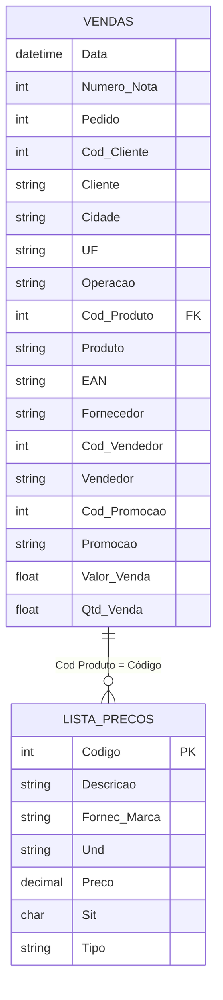

# Fitoherb Sales Predictor

Repositório para modelagem preditiva, análise exploratória e previsão de vendas para a distribuidora de produtos naturais e suplementos Fitoherb.

---

## 🔒 Proteção e Privacidade de Dados (LGPD)

Para garantir a segurança comercial e a conformidade com a LGPD (Lei Geral de Proteção de Dados):
- **Nenhum dado real ou confidencial de vendas, preços, clientes ou notas fiscais é versionado no Git.**
- O arquivo `.gitignore` bloqueia automaticamente planilhas, arquivos de dados (`*.csv`, `*.xlsx`, `*.xls`, `*.parquet`, etc.), a pasta local `datasets/`, bem como arquivos internos de IA (`.agents/`, `AGENTS.md`).
- Para uso local com dados reais, organize os arquivos dentro de `datasets/` com os nomes padronizados:
  - `datasets/vendas.csv`: Histórico consolidado de vendas.
  - `datasets/lista_precos.csv`: Relatório/tabela de preços oficial.
- Para fins de demonstração, desenvolvimento, testes unitários e CI/CD, o repositório disponibiliza templates higienizados e 100% anonimizados no diretório [`templates/`](./templates/).

---

## 📊 Estrutura das Tabelas

Abaixo estão as especificações e amostras de como os dados estão organizados no projeto.



---

### 1. Tabela de Histórico de Vendas

- **Arquivo de Template:** [`templates/vendas_template.csv`](./templates/vendas_template.csv)
- **Delimitador:** Vírgula (`,`), strings delimitadas por aspas (`"`)
- **Granularidade:** 1 linha por item faturado na nota fiscal.

| Data | Numero Nota | Pedido | Cod Cliente | Cliente | Cidade | UF | Operação | Cod Produto | Produto | EAN | Fornecedor | Cod Vendedor | Vendedor | Cod Promocao | Promoção | Valor Venda | Qtd Venda |
|---|---|---|---|---|---|---|---|---|---|---|---|---|---|---|---|---|---|
| `2025-01-10 00:00:00.000` | `100001` | `50001` | `101` | `FARMACIA MODELO LTDA` | `SALVADOR` | `BA` | `VENDA` | `500101` | `COLAGENO HIDROLISADO 300G` | `7890000000011` | `FITONUTRI BRASIL` | `10` | `CARLOS SILVA` | `0` | `""` | `49.90` | `1.0` |
| `2025-01-10 00:00:00.000` | `100001` | `50001` | `101` | `FARMACIA MODELO LTDA` | `SALVADOR` | `BA` | `VENDA` | `500104` | `OMEGA 3 1000MG 120 CAPS` | `7890000000042` | `LABORATORIO NATURALIS` | `10` | `CARLOS SILVA` | `101` | `CAMPANHA VERAO 2025` | `91.80` | `2.0` |
| `2025-01-11 00:00:00.000` | `100002` | `50002` | `102` | `DROGARIA POPULAR LTDA` | `FEIRA DE SANTANA` | `BA` | `VENDA` | `500102` | `CREATINA MONOHIDRATADA 300G` | `7890000000028` | `VITA LIFE NUTRICAO` | `11` | `ANA SOUZA` | `0` | `""` | `79.90` | `1.0` |
| `2025-01-12 00:00:00.000` | `100003` | `50003` | `103` | `MERCADO NATURAL LTDA` | `ARACAJU` | `SE` | `VENDA` | `500106` | `WHEY PROTEIN 900G BAUNILHA` | `7890000000066` | `VITA LIFE NUTRICAO` | `12` | `MARCOS OLIVEIRA` | `0` | `""` | `179.80` | `2.0` |

---

### 2. Tabela de Lista de Preços e Catálogo

- **Arquivo de Template (ERP):** [`templates/lista_precos_template.csv`](./templates/lista_precos_template.csv)
- **Arquivo de Template (Tabular Limpo):** [`templates/lista_precos_limpa_template.csv`](./templates/lista_precos_limpa_template.csv)
- **Delimitador:** Ponto e vírgula (`;`)
- **Granularidade:** 1 linha por produto cadastrado na tabela de preços ativa.

| Código | Descrição | Fornec/Marca | Und | Preço | Sit | Tipo |
|---|---|---|---|---|---|---|
| `500101` | `COLAGENO HIDROLISADO 300G` | `FITONUTRI BRASIL` | `UN` | `49,90` | `A` | `LINHA FITONUTRI` |
| `500102` | `CREATINA MONOHIDRATADA 300G` | `VITA LIFE NUTRICAO` | `UN` | `79,90` | `A` | `LINHA VITA LIFE` |
| `500103` | `MULTIVITAMINICO A-Z 60 CAPS` | `LABORATORIO NATURALIS` | `UN` | `29,90` | `B` | `LINHA NATURALIS` |
| `500104` | `OMEGA 3 1000MG 120 CAPS` | `LABORATORIO NATURALIS` | `UN` | `45,90` | `A` | `LINHA NATURALIS` |
| `500105` | `VITAMINA C 500MG 60 CAPS` | `LABORATORIO NATURALIS` | `UN` | `19,90` | `A` | `LINHA NATURALIS` |

> Legenda do campo `Sit` (Situação de Estoque):
> - `A`: Cobertura de estoque acima de 30 dias.
> - `B`: Cobertura de estoque entre 15 e 30 dias.
> - `C`: Cobertura de estoque abaixo de 15 dias.

---

## 🚀 Como Utilizar no Desenvolvimento

### Leitura com Python / Pandas

```python
import pandas as pd

# Carregar vendas
df_vendas = pd.read_csv("templates/vendas_template.csv", parse_dates=["Data"])

# Carregar lista de preços (ignorando as 4 linhas de cabeçalho do ERP)
df_precos = pd.read_csv(
    "templates/lista_precos_template.csv",
    sep=";",
    skiprows=4,
    decimal=",",
    encoding="utf-8"
)
df_precos = df_precos.loc[:, ~df_precos.columns.str.contains('^Unnamed')]

# Cruzamento dos dados
df = df_vendas.merge(df_precos, left_on="Cod Produto", right_on="Código", how="left")
print(df.head())
```

Para mais detalhes sobre tipos de campos e convenções, consulte a documentação detalhada em [`templates/README.md`](./templates/README.md).
