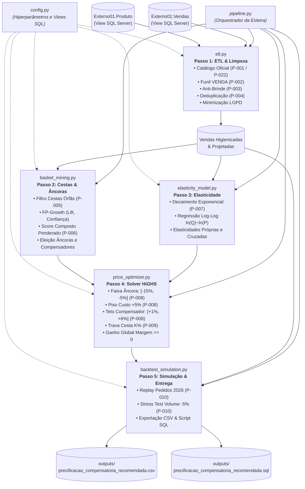

# Módulos do Sistema de Precificação (`src/`) 🧠📦

Este diretório contém o código-fonte modular do **Fitoherb Sales Predictor**, projetado com separação estrita de responsabilidades, tipagem estática (Type Hints), princípios de Clean Code e alinhamento com a arquitetura descrita em [`.agents/docs/architecture/ARCHITECTURE.md`](../.agents/docs/architecture/ARCHITECTURE.md).

---

## 🗺️ Visão Geral do Fluxo entre Módulos

---

## 📄 Descritivo Detalhado dos Arquivos

### 1. `config.py`
- **Objetivo:** Centralizar todas as constantes de negócio, configurações das views do SQL Server e hiperparâmetros configuráveis da aplicação.
- **Pra que serve:** Evitar "números mágicos" espalhados pelo código e permitir que a pipeline seja reconfigurada via dataclass imutável (`PipelineConfig`) ou por argumentos de linha de comando na CLI (`main.py`).
- **Lógica por trás:** Implementa a classe `@dataclass(frozen=True) PipelineConfig`, que define valores padrão seguros e validados:
  - Views do SQL Server (`products_view = "Externo01.Produto"`, `sales_view = "Externo01.Vendas"`).
  - Limiar anti-brinde (`min_price_ratio = 0.40`).
  - Percentil de corte de outliers (`outlier_percentile = 99.5`).
  - Meia-vida do decaimento temporal (`temporal_half_life_days = 100.0`).
  - Restrições do solver (`anchor_min_discount = -0.15`, `anchor_max_discount = -0.05`, `comp_max_increase = 0.06`, `k_basket_ratio = 0.25`).

---

### 2. `etl.py`
- **Objetivo:** Ingestão de dados do SQL Server (ou fontes tabulares), higienização rigorosa, eliminação de ruídos e garantia de conformidade com a LGPD.
- **Pra que serve:** Conecta-se às views corporativas `Externo01.Produto` e `Externo01.Vendas`, transformando o catálogo e transações de venda em uma base analítica limpa, enriquecida e otimizada para memória.
- **Lógica por trás:**
  - `load_catalog_from_database()` (**Regra P-022**): Extrai os produtos diretamente da View `Externo01.Produto` do SQL Server. Normaliza colunas (`Codigo` -> `Código`, `Descricao` -> `Descrição`, `Fornecedor` -> `Fornec/Marca`, `Pc.Venda` -> `Preço`, e `Pc.Ultimo Custo` -> `Custo`), garantindo tipos sanitizados e custo de aquisição real.
  - `load_catalog()`: Ponto de entrada polimórfico. Se chamado sem argumentos, extrai diretamente do SQL Server; se receber um DataFrame ou arquivo, aplica a normalização canônica.
  - `filter_whitelist()` (**Regra P-001**): O catálogo é a fonte da verdade. Qualquer SKU presente nas vendas que não exista no catálogo é sumariamente expurgado.
  - `clean_sales_data()` (**Regras P-002 e P-003**):
    - Filtra estritamente `Operação == 'VENDA'`, descartando devoluções, bonificações, amostras e trocas.
    - Expurga registros com quantidade ou valor $\le 0$.
    - Calcula o preço unitário praticado ($P_{\text{praticado}} = \text{Valor Venda} / \text{Qtd Venda}$). Se $P_{\text{praticado}} < 0.40 \times P_{\text{tabela}}$, a linha é descartada (elimina brindes faturados a R$ 0,01 que distorceriam as curvas de elasticidade).
  - `deduplicate_orders()` (**Regra P-004**): Aplica agregação `GROUP BY (Pedido, Cod Produto)` somando quantidade e valor caso o mesmo SKU tenha sido lançado fracionado na mesma nota.
  - `remove_outliers()` (**Regra P-004**): Calcula a quantidade total por pedido, identifica o percentil 99.5 e descarta pedidos que ultrapassem esse limiar (elimina compras hospitalares atípicas ou licitações).
  - `run_etl_pipeline()` (**Minimização LGPD**): Projeta apenas as colunas estritamente necessárias (`Pedido`, `Data`, `Cod Produto`, `Valor Venda`, `Qtd Venda`, `Cod Cliente`, `UF`, `Preco Tabela`, `Custo Unitario`), descartando dados pessoais de clientes e vendedores.

---

### 3. `basket_mining.py`
- **Objetivo:** Minerar padrões frequentes de compra conjunta (Market Basket Analysis) e eleger os produtos âncora e seus respectivos compensadores.
- **Pra que serve:** Descobrir quais produtos atraem os clientes (âncoras) e quais itens são historicamente colocados no mesmo carrinho para serem os "financiadores" da margem (compensadores).
- **Lógica por trás:**
  - `filter_orphan_baskets()` (**Regra P-005**): Pedidos que após o filtro de catálogo contenham menos de 2 SKUs válidos são descartados da mineração de regras, pois uma cesta individual não expressa afinidade entre produtos.
  - `build_basket_matrix()`: Transforma a tabela relacional de pedidos em uma matriz esparsa binária booleana ($\text{Pedido} \times \text{SKU}$).
  - `mine_association_rules()`: Executa o algoritmo **FP-Growth** (`mlxtend`), que comprime as transações em uma árvore de prefixos compacta (FP-Tree), sendo ordens de magnitude mais rápido que o Apriori tradicional. Extrai métricas de **Suporte** ($P(A \cap B)$), **Confiança** ($P(B|A)$) e **Lift** ($\frac{P(A \cap B)}{P(A) \cdot P(B)}$).
  - `calculate_anchor_score()` (**Regra P-006**): Calcula o Score Composto Ponderado de cada SKU:
    $$\text{Score} = 0.40 \times \text{Giro\_Normalizado} + 0.35 \times \text{Penetracao\_Pedidos} + 0.25 \times \text{Centralidade\_Lift}$$
    - *Giro:* Volume faturado recente em 2026.
    - *Penetração:* Fração de pedidos únicos da distribuidora que incluem o SKU.
    - *Centralidade Lift:* Média de Lift quando o produto aparece como antecedente.
  - `select_anchors_and_compensators()`: Elege os Top $N$ SKUs com maior score como Âncoras e mapeia, para cada um, os itens complementares com maior Lift e Confiança.

---

### 4. `elasticity_model.py`
- **Objetivo:** Modelar matematicamente a sensibilidade de demanda em relação ao preço unitário praticado, priorizando o comportamento recente.
- **Pra que serve:** Estimar o impacto na quantidade vendida quando aumentamos ou diminuímos o preço de um produto ($\Delta Q / \Delta P$).
- **Lógica por trás:**
  - `calculate_temporal_decay_weights()` (**Regra P-007**): Calcula o peso de cada transação histórica usando decaimento exponencial:
    $$\text{sample\_weight} = 2^{-\frac{\Delta \text{dias}}{\text{meia\_vida}}}$$
    Vendas recentes de 2026 possuem peso $\approx 1.0$; dados de 2023 a 2025 recebem peso decrescente, servindo para calibrar variações passadas de preço sem permitir que hábitos defasados contaminem o modelo.
  - `estimate_log_log_elasticity()`: Ajusta uma regressão linear ponderada no espaço logarítmico:
    $$\ln(Q_i) = \alpha_i + \beta_{ii} \ln(P_i) + \epsilon$$
    onde o coeficiente angular $\beta_{ii}$ representa diretamente a elasticidade constante ($\% \Delta Q / \% \Delta P$). O módulo aplica filtros econômicos defensivos: se o histórico tiver pouca dispersão de preço ou gerar $\beta \ge 0$ (efeito espúrio), aplica o valor canônico calibrado de literatura B2B farmacêutica (-1.2).
  - `build_elasticity_matrix()`: Constrói o dicionário de elasticidades próprias ($\beta_{ii} < 0$) e cruzadas ($\beta_{ij} < 0$ para bens complementares de cesta).

---

### 5. `price_optimizer.py`
- **Objetivo:** Motor de Pesquisa Operacional que prescreve a variação ótima de preço para cada SKU da cesta comercial.
- **Pra que serve:** Determinar exatamente quantos reais ou percentuais conceder de desconto no produto isca e quanto reajustar nos compensadores para maximizar o lucro total sem violar nenhuma regra comercial.
- **Lógica por trás:**
  - Formulação matemática em **Programação Linear** resolvida pelo solver **HiGHS** (via `scipy.optimize.linprog(method='highs')`).
  - **Variáveis de Decisão:** $x_i = \Delta P_i / P_i^0$ (variação percentual de preço).
  - **Função Objetivo:** Maximizar o Lucro Bruto Total Projetado da Distribuidora:
    $$\text{Maximizar } \sum_{i} Q_i^0 \cdot \left[ P_i^0 (1 + \beta_{ii}) - C_i \beta_{ii} \right] \cdot x_i$$
  - **Restrições Mandatórias:**
    1. *Desconto no Âncora:* $-0.15 \le x_{\text{ancora}} \le -0.05$ (desconto entre 5% e 15%).
    2. *Piso de Margem no Âncora:* $P_{\text{novo\_ancora}} \ge Custo_{\text{ancora}} \times 1.05$ (nenhum produto vendido abaixo de 5% de margem sobre o custo).
    3. *Teto de Reajuste nos Compensadores:* $+0.01 \le x_{\text{comp}} \le +0.06$ (reajuste sutil entre 1% e 6%, imperceptível ao comprador B2B).
    4. *Neutralidade de Margem Global:* $\sum_i \Delta \text{Margem}_i \ge 0$ (garantia de lucro $\ge 0$).
    5. *Trava Comercial da Cesta ($K\%$):*
       $$P_{\text{novo\_ancora}} \cdot Q_{\text{ancora}} \le \left(\frac{K}{1 - K}\right) \sum_{j \in \text{Compensadores}} \left[ P_{\text{novo\_j}} \cdot Q_j \right]$$
  - Caso o ponto inicial da cesta de um SKU seja hiperdesbalanceado, o otimizador aplica relaxamento progressivo determinístico mantendo estrita a trava de neutralidade de margem.

---

### 6. `backtest_simulation.py`
- **Objetivo:** Validação retroativa em pedidos reais, simulação de Monte Carlo de cenários adversos de mercado e exportação de entregáveis finais.
- **Pra que serve:** Provar a viabilidade econômica antes de colocar os novos preços em produção e gerar os arquivos que o ERP Atrio precisa consumir.
- **Lógica por trás:**
  - `simulate_2026_replay()` (**Regra P-010**): Recalcula todos os pedidos de 2026 com a nova tabela de preços e mede a proporção de pedidos que naturalmente atendem à trava comercial $K \le 25\%$.
  - `stress_test_volume_drop()` (**Regra P-010**): Simula o que aconteceria se os produtos compensadores que sofreram reajuste de +6% perdessem de 3% a 5% de volume por reação adversa do mercado. Verifica se a margem global permanece protegida (`lucro_liquido_estresse >= 0`).
  - `generate_consolidated_recommendation()`: Compila o catálogo de 1.398 produtos com seus respectivos papéis (`PRODUTO ÂNCORA`, `COMPENSADOR`, `NEUTRO`), gerando a tabela consolidada em CSV e o script SQL transacional com comandos `UPDATE` para o banco de dados.

---

### 7. `pipeline.py`
- **Objetivo:** Orquestrar o fluxo de execução ponta a ponta conectando todos os módulos acima.
- **Pra que serve:** Fornecer uma interface programática única `run_full_pricing_pipeline(config)` que executa a esteira de forma limpa, loga cada etapa e retorna um resumo executivo estruturado com métricas e caminhos de arquivos.
- **Lógica por trás:**
  - Executa: Carga $\rightarrow$ ETL $\rightarrow$ Mineração FP-Growth $\rightarrow$ Scoring de Âncoras $\rightarrow$ Modelagem de Elasticidade $\rightarrow$ Otimização HiGHS $\rightarrow$ Backtesting Replay $\rightarrow$ Stress Test $\rightarrow$ Exportação de Artefatos.
  - Trata erros defensivamente e exibe logs informativos em cada etapa.

---

### 8. `api.py`
- **Objetivo:** Servidor de API RESTful assíncrona desenvolvido com **FastAPI** e validações estritas em **Pydantic v2**.
- **Pra que serve:** Fornecer os endpoints de integração com a aplicação web Angular, viabilizando simulações em tempo real de KPIs de precificação, download direto do CSV de recomendação e acionamento do motor de Auto-Tuning com Algoritmo Genético.
- **Lógica por trás:**
  - Cache de dados em memória (`_DATA_CACHE`) para reaproveitamento entre requisições sem reprocessar ETL desnecessariamente.
  - Endpoints implementados:
    - `GET /api/v1/health`: Verificação de status do servidor e checagem de integridade dos datasets.
    - `POST /api/v1/pricing/simulate`: Executa o pipeline de precificação com os parâmetros recebidos e retorna métricas estruturadas de faturamento projetado, taxa de elegibilidade e lucro sob estresse.
    - `POST /api/v1/pricing/download-csv`: Executa a otimização e transmite o arquivo CSV de recomendação consolidada para download no navegador via `StreamingResponse`.
    - `POST /api/v1/pricing/auto-tune`: Dispara a busca meta-heurística evolutiva de hiperparâmetros ótimos para o perfil estratégico selecionado.

---

### 9. `meta_tuner.py`
- **Objetivo:** Motor de Meta-Otimização de Hiperparâmetros de Precificação utilizando **Algoritmo Genético (AG)** em NumPy puro (sem dependências externas pesadas).
- **Pra que serve:** Descobrir automaticamente os valores ideais para os 6 hiperparâmetros centrais do sistema ($K\%$, Quantidade de Âncoras, Meia-Vida, Faixa de Desconto e Teto Compensador) de acordo com o objetivo de negócio da distribuidora.
- **Lógica por trás:**
  - **Cromossomo de 6 Genes:**
    - Gene 0: `k_ratio` $\in [0.15, 0.40]$
    - Gene 1: `top_anchors` $\in [5, 25]$ (inteiro)
    - Gene 2: `half_life` $\in [45.0, 180.0]$
    - Gene 3: `anchor_min_discount` $\in [-0.20, -0.08]$
    - Gene 4: `anchor_max_discount` $\in [-0.07, -0.03]$
    - Gene 5: `comp_max_increase` $\in [0.03, 0.10]$
  - **Operadores Genéticos:**
    - *Seleção por Torneio ($k=3$):* Garante forte pressão seletiva mantendo diversidade genética.
    - *Crossover Aritmético com Blend Aleatório ($p_c=0.85$):* Gera filhos por interpolação convexa no espaço contínuo.
    - *Mutação Gaussiana Adaptativa com Truncamento ($p_m=0.25$):* Perturba os genes dentro dos limites comerciais seguros.
    - *Elitismo ($E=2$):* Preserva invariavelmente os 2 melhores indivíduos de cada geração.
    - *Memoização de Fitness:* Cache em memória que evita recalcular combinações genéticas repetidas.
  - **Perfis Estratégicos Suportados:**
    - `balanced`: Equilíbrio harmônico entre receita projetada, taxa de elegibilidade da trava e margem líquida sob estresse.
    - `profit_focused`: Prioriza o lucro líquido sob estresse financeiro e minimiza a concessão de descontos excessivos.
    - `volume_focused`: Prioriza a taxa de elegibilidade e o giro das cestas comerciais, permitindo descontos maiores com trava calibrada.

---

### 10. `__init__.py`
- **Objetivo:** Declarar o diretório `src/` como um pacote Python oficial e expor a versão semântica do sistema (`__version__ = "1.0.0"`).

---

## 🛠️ Como Adicionar Novos Modelos ou Regras

1. **Adicionar novos algoritmos de Machine Learning (ex: LightGBM Regressor / CatBoost):**
   - Implemente o estimador dentro de `src/elasticity_model.py` preservando a assinatura da função que retorna a elasticidade $\beta$.
2. **Customizar a Função Objetivo ou Restrições do Solver:**
   - Edite a função `optimize_basket_pricing()` em `src/price_optimizer.py`. Adicione novas linhas na matriz $A_{ub}$ e no vetor $b_{ub}$.
3. **Novas Métricas de Cestas:**
   - Adicione novos cálculos em `src/basket_mining.py` e inclua o termo ponderado na função `calculate_anchor_score()`.
4. **Adicionar Novos Genes ou Estratégias no Algoritmo Genético:**
   - Edite `GENE_BOUNDS` e a função de aptidão `_evaluate_fitness()` em `src/meta_tuner.py`.
